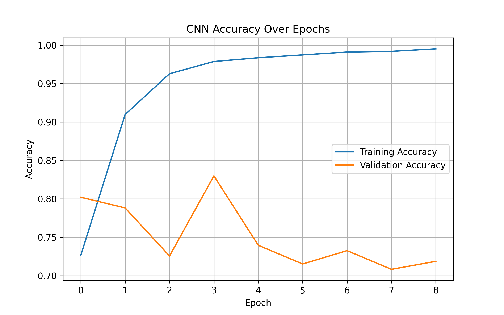
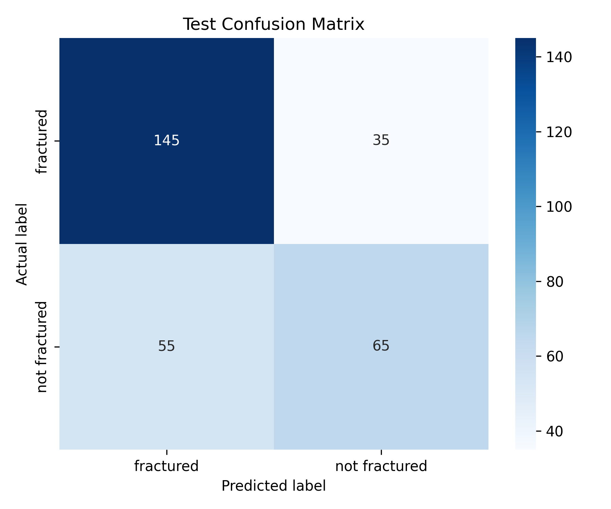

# Bone Fracture Detection from X-Ray Images Using CNN

A deep learning project that classifies X-Ray images into **Fractured** or **Not Fractured** using a custom Convolutional Neural Network (CNN) built with TensorFlow and Keras.

## 📌 Overview
This project processes bone X-Ray datasets to automate fracture detection. The pipeline handles data extraction, dataset shuffling to prevent data leakage, image resizing, batching, CNN architecture training with dropout regularization, and detailed metric evaluations using confusion matrices.

## 🛠️ Tech Stack
- Python
- TensorFlow, Keras
- NumPy, scikit-learn
- Matplotlib, Seaborn

## 📊 Dataset
- **Image Size:** 128x128 pixels (RGB)
- **Target Classes:** fractured, not fractured
- Source: [Bone Fracture Detection Dataset]([https://kaggle.com](https://www.kaggle.com/datasets/devbatrax/fracture-detection-using-x-ray-images) (Kaggle)

## ⚙️ Workflow
1. Dataset extraction (`!unzip`)
2. Data loading and validation pool setup (`image_dataset_from_directory`)
3. Validation and Test subset parsing with stream optimization (`prefetch`)
4. CNN Architecture design (3 Conv-Pool blocks, Flatten, Dense, Dropout)
5. Model compiling (Adam optimizer, Binary Cross-Entropy loss)
6. Model training with early stopping and checkpoint tracking
7. Metrics extraction and true label alignment (`unbatch`)
8. Evaluation — Accuracy, Classification Report, and Confusion Matrix heatmap

## 📈 Performance Analysis & Results
Upon testing the model on the isolated test set (312 images total), the model achieved an overall **Accuracy of 48.4%**. Below is the detailed breakdown of the classification performance:

### 1. Class Performance Breakdown
- **Fractured (Positive Class):**
  - **Precision (58%):** Out of all cases where the model predicted a fracture, 58% were actually fractured.
  - **Recall (56%):** The model correctly caught 56% of all true fractures present in the dataset, missing 44% (False Negatives).
  - **F1-Score (57%):** Represents a balanced harmonic mean between precision and recall for fractures.
- **Not Fractured (Negative Class):**
  - **Precision (35%):** Only 35% of the "not fractured" predictions were correct.
  - **Recall (37%):** The model only identified 37% of the healthy bone images correctly.

## 🖼️ Visualizations

### Learning Curve

*Training vs. Validation accuracy curves showing convergence and training behavior across epochs.*

### Model Evaluation

*Confusion matrix indicating true positives, true negatives, false positives, and false negatives calculated over unbatched test data.*

## 🚀 How to Run
1. Clone the repository
2. Ensure you have the dataset zip file uploaded as `archive.zip` in your working directory.
3. Install dependencies:
```bash
pip install tensorflow numpy scikit-learn matplotlib seaborn
```
4. Open your Jupyter Notebook or Google Colab environment and run all cells sequentially.
